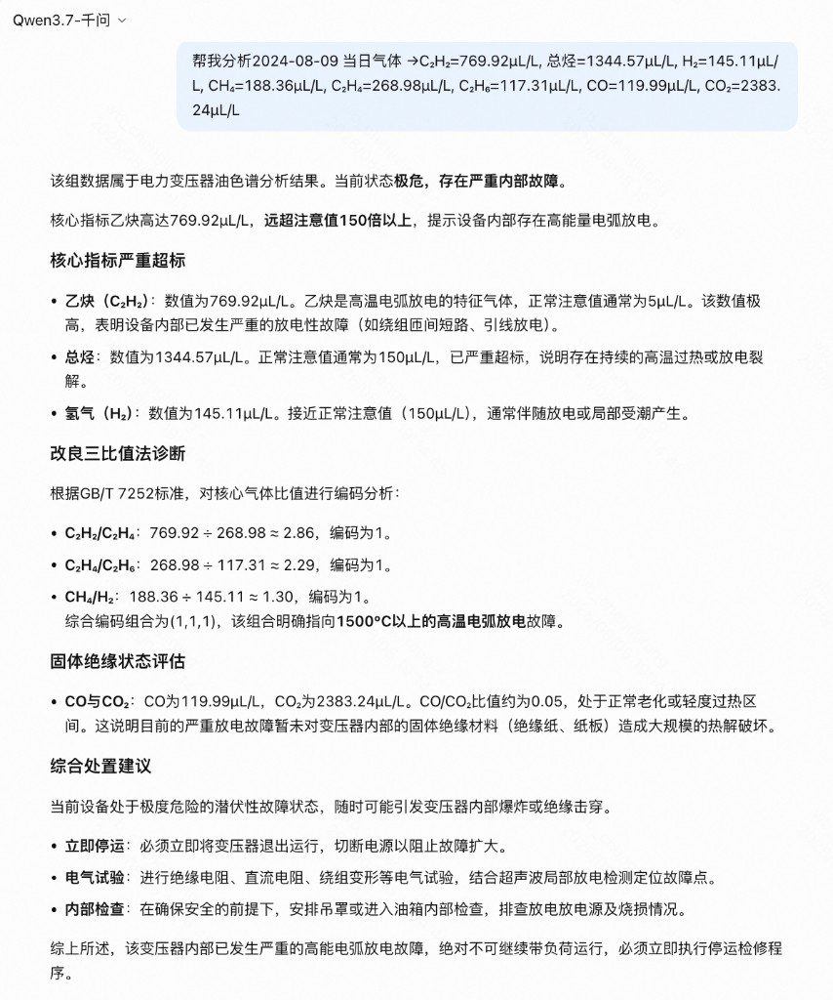
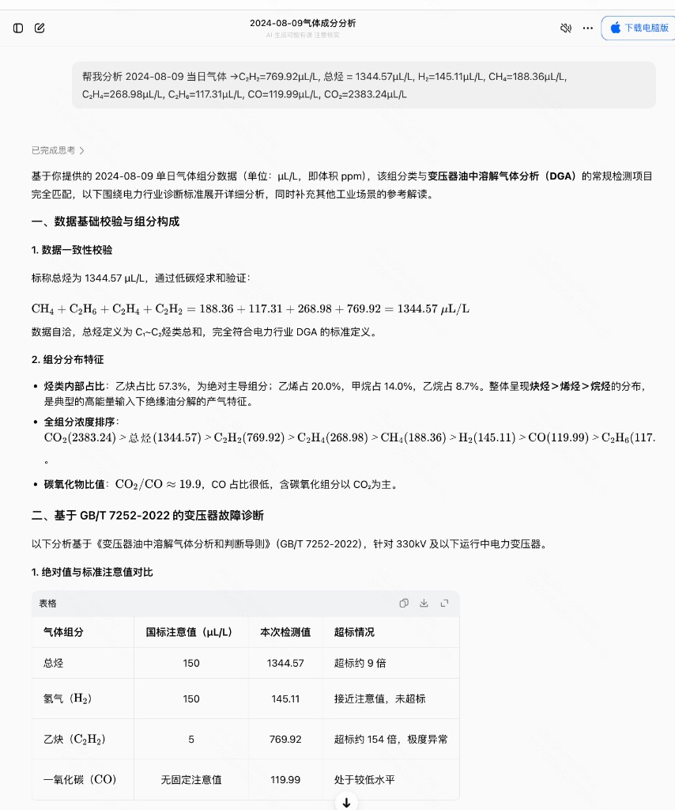
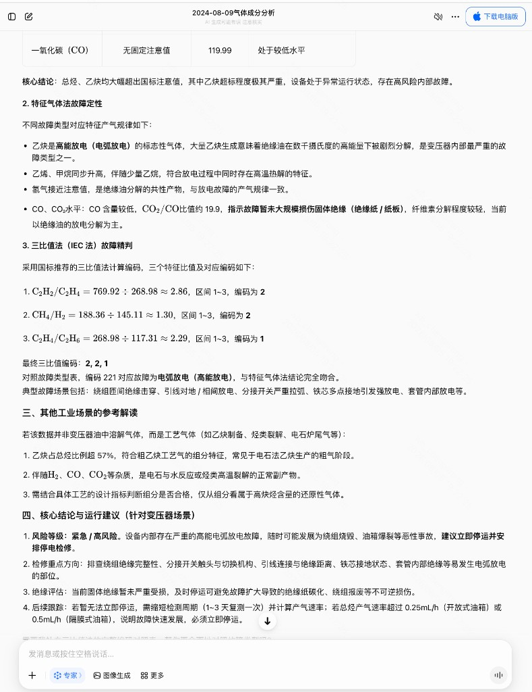

# 附录

## 附录A　模块—行业标准条文对照表

本附录汇总系统各分析模块的主要输出及其行业标准依据，便于与正文核对。对照关系如表A1所示。

表A1　模块—行业标准条文对照表

| 系统模块 | 主要输出 | 主要依据 |
| ---- | ---- | ---- |
| 检测分级 | 四档检测分级、各项指标明细 | DL/T 1498.2—2025表A.3；参比值按该标准A.3.3 |
| 产气趋势与涨势预警 | 总烃月环比、涨势预警 | DL/T 722—2014第9.3.2条、第9.3.3条a） |
| 处置紧急度 | 高、中、低 | DL/T 722—2014第9.3.3条 |
| 特征气体法 | 故障类型（对照表5） | DL/T 722—2014表5 |
| 三比值法 | 编码与故障类型（对照表6、表7） | DL/T 722—2014表6、表7 |
| 大卫三角形法 | 分区与故障类型 | DL/T 722—2014附录C |
| 交叉研判与可信度 | 主结论、可信度、暂定标志 | 本文第3章方法 |
| 试验建议 | 试验项目清单 | DL/T 722—2014附录D；DL/T 1685—2017附录B |
| 监测决策 | 检测周期、二次采样建议 | DL/T 1498.2—2025中A.3.1、第5.5.5条、第5.4.5条；DL/T 722—2014第9.3.3条 |
| 报告 | 分析报告及PDF | DL/T 722—2014 |
| 智能体工作流 | 七步编排与运行日志 | 七步顺序由本系统固定编排（本文第4章） |
| 分析助手 | 触发分析、依据解释、标准问答 | 调用上述模块与同一套七步编排 |

## 附录B　通用大语言模型直接作答对话摘录

本附录收录第4.8.5节2024-08-09监测日示例对照的对话截图，与正文表4.2对应。通义千问所用模型为Qwen3.7，豆包所用为专家模式（2.1 Turbo）。

图B1　通义千问直接作答（仅提供当日气体数据）

图B2　豆包直接作答（一）

图B3　豆包直接作答（二）

